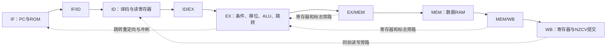

# EGO1 ARM A32 五级流水线 CPU：21 条指令阶段

> 2026-10-31：用户报告处理板卡硬件问题后，原版 `download/ego1_arm_pipeline.bit` 已正常下载，日志为 startup HIGH，D15 常亮、D16 闪烁。主工程已恢复原自动启动顶层及约束，按修改前备份核对哈希一致。D14 状态及复位重跑尚待补充确认。手动启动诊断版保留在独立快照工程中，见 [MANUAL_START_TEST.md](MANUAL_START_TEST.md)。

本工程将已经上板验证的 ARM 单周期子集改为 IF、ID、EX、MEM、WB 五级流水线。实现寄存器/标志旁路、加载暂停、分支冲刷及实验错误停止。MUL、SDIV、UDIV 尚未加入，不能把此阶段视为已经完成第四题。

## 打开与下载

工程：`D:/Code/Vivado/ego1_arm_pipeline/ego1_arm_pipeline.xpr`

设计顶层：`ego1_arm_pipeline_top`。器件：`xc7a35tcsg324-1`。仿真顶层：`tb_arm_pipeline`。

构建成功后的下载文件：`D:/Code/Vivado/ego1_arm_pipeline/download/ego1_arm_pipeline.bit`。具体时序和构建结果见 `reports/build_result.txt`。

2026-10-28 已完成本机 Vivado 2025.2 的综合、布局布线和压缩 bitstream 生成：建立时间裕量 6.306ns，保持时间裕量 0.038ns，全部指定时序约束满足，内部未约束端点为 0；DRC 0 问题，CDC 两条连接均为安全/信息级。文件为 669635 字节，已与实现目录原始输出核对哈希一致。

本版 USR_ACCESS 标记为 `41525031`。如需在下载后辨认实际版本，可在 Vivado Tcl Console 查询 `get_property REGISTER.USR_ACCESS [get_hw_devices xc7a35t_0]`。2026-10-31 用户已确认原版配置成功，D15 常亮、D16 闪烁；D14 及复位重跑尚待补充。

原工程 `D:/Code/Vivado/ego1_arm_single_cycle` 保持独立，作为已通过上板验证的单周期参考。请核对完整的 `.xpr` 和 `.bit` 路径。

连接开发板时使用此前已经验证有效的 125000Hz JTAG 扫描频率。打开新连接后可以先查询 `get_property PARAM.FREQUENCY [get_hw_targets *]`。若为 15000000 且扫描失败，在当前 Vivado Tcl Console 依次执行：

```tcl
catch {close_hw_target}
set_property PARAM.FREQUENCY 125000 [get_hw_targets *]
open_hw_target
```

识别 `xc7a35t_0` 后，Program Device 选择本工程的 `.bit`。这只调整下载器扫描频率；板上 CPU 仍为 1MHz。

| 指示灯 | 正常预期 |
|---|---|
| D16/K3 | 独立心跳，0.5 秒翻转一次 |
| D15/M1 | 程序完成、结果为 12/15/1 后常亮 |
| D14/L1 | 正常熄灭；CPU 或完成检查错误时亮起 |

按住 S0/R11，D15、D14 应熄灭，K3 继续闪烁；松开后 D15 应重新亮起。此复位重跑操作尚待用户补充确认；原版配置及 D15/D16 现象已确认。

## 五级结构



四组阶段寄存器在 `rtl/arm_pipeline_cpu.sv` 中分别为 `fd`、`e`、`m`、`w`。使用 SystemVerilog packed struct 整理阶段寄存器，Vivado 直接支持。其他基本模块采用 Verilog。

`pc` 是取指 PC，可能指向预取或错误路径；`trace_pc` 是实际退休指令的 PC。R15 的读值使用 ID 中对应指令的 PC+8，而不是取指 PC。每级携带 valid，空泡及被冲刷指令不产生写入。

## 指令与存储器

保留原单周期的 21 条真实基础指令：ADD、SUB、RSB、ADC、SBC、AND、ORR、EOR、BIC、MOV、MVN、CMP、CMN、TST、LDR、STR、LDRB、STRB、B、BL、BX。

范围与单周期版本一致：A32 标准条件码及 AL；旋转立即数和立即数控制的寄存器移位；运算 S 形式；不回写基址的正/负立即数偏移访存；BX 只接受 A32 对齐目标。尚不支持 Thumb、完整特权架构、普通运算/加载写 PC、寄存器控制移位和复杂基址回写。

程序 ROM 与数据 RAM 分离；RAM 范围 0x1000～0x10FF，小端，字访问要求 4 字节对齐。0x1000、0x1004、0x1008 分别保存结果 12、循环和 15、完成标记 1。

## 冒险处理的具体实现

| 情况 | 当前实现 |
|---|---|
| 相邻 ALU 结果依赖 | EX/MEM→EX 优先，其次 MEM/WB→EX；ARM R0 正常参与匹配 |
| WB 写、ID 读同拍 | `arm_pipeline_regfile.v` 显式旁路 |
| load-use | 暂停 PC、IF/ID 一拍，ID/EX 注入空泡，老指令继续前进 |
| 存储数据与 BX 地址依赖 | 使用真实源寄存器编号，加入相同的旁路与加载检测 |
| NZCV 依赖 | EX 使用最新 EX/MEM、MEM/WB 标志，最后才使用已提交 NZCV |
| 部分标志更新 | 逻辑 S/TST 使用最新 V 等保留位；ADC/SBC/RRX 使用最新 C |
| 条件不成立 | 不写寄存器、标志、内存；不会成为后续指令的旁路生产者 |
| 分支/跳转成立 | EX 重定向 PC，冲刷 IF/ID 与 ID/EX，保留较老指令 |
| 结构冲突 | 指令 ROM 与数据 RAM 分开，两读一写寄存器堆 |

较高优先级的老 MEM 错误覆盖年轻 EX 跳转。取指失败先作为标记随指令前进，错误路径上的无效预取被冲刷后不会触发 fault。实际错误会取消年轻指令、让老指令排空，再在 WB 设置 sticky fault 和 fault_pc。写内存发生于 MEM，退休跟踪在 WB；测试同时统计真实写入次数，避免仅检查跟踪输出而漏掉错误路径副作用。

这里的 fault 是课设实验诊断，复位清除，不等价于完整 ARM 异常处理体系。

## 验证与优化证据

`scripts/build_programs.py` 使用真实 LLVM ARM 汇编器和独立 Python 汇编语义参考模型。原演示、600 条随机指令及定向冒险程序在单周期、带旁路流水线、仅暂停流水线三种 CPU 上运行，逐条比较 PC、指令、条件、寄存器、访存、NZCV。

CPU 仿真共 40579 项检查通过。20 组错误测试同时覆盖两种流水线配置，确认老指令的寄存器、标志及存储能完成，年轻指令没有副作用，fault_pc 正确，复位有效。

板级 26 项检查通过，包含实际 /100 分频、启动、重复复位、保留 RAM 后重跑、心跳和错误指示。板级程序与原 ARM 单周期演示程序的机器码一致。

性能数据见 `PERFORMANCE.md`、`reports/performance.csv` 和原始 `reports/cpu_simulation.log`。

## 阅读与观察顺序

1. `rtl/arm_decode.v`：真实源寄存器与标志依赖的判断。
2. `rtl/arm_pipeline_regfile.v`：R0/R15、WB→ID 旁路。
3. `rtl/arm_pipeline_cpu.sv`：四组阶段寄存器、旁路、暂停、冲刷、WB 提交和错误优先级。
4. `programs/hazards.s`：定向冒险程序；其中两条 UDF 机器码是必须被跳过的错误路径测试。
5. `sim/tb_arm_pipeline.sv`：三种 CPU 的结果与周期比较。

默认 Run Behavioral Simulation 运行 CPU 全部测试。在 Scope 中选择 `g_image[0] → g_core[1] → test → dut → g_pipeline → cpu` 可观察带旁路 CPU 的 `fd/e/m/w`、`stall`、`redirect`、`ex_flags` 和退休跟踪。将 `tb_ego1_arm_pipeline_top` 设为仿真顶层可观察板级测试。

仿真中的周期和事件统计端口没有接到物理外设，未使用的统计逻辑可能被综合优化。`There are no debug cores` 对当前未插入 ILA 的工程属于正常提示。
