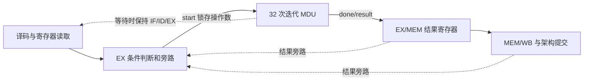

# 乘除单元接入五级流水线

## 编码与译码

`arm_decode.v` 把 MUL、SDIV、UDIV 从普通 ALU/访存指令中单独识别，显式给出两个源寄存器、目的寄存器、操作类别和标志写使能。

| 指令 | 固定编码字段（不含 cond） | Rd | 源操作数 |
|---|---|---|---|
| MUL/MULS | [27:21]=0，[15:12]=0，[7:4]=9 | [19:16] | [3:0] × [11:8] |
| SDIV | [27:20]=0x71，[15:12]=0xf，[7:4]=1 | [19:16] | [3:0] ÷ [11:8] |
| UDIV | [27:20]=0x73，[15:12]=0xf，[7:4]=1 | [19:16] | [3:0] ÷ [11:8] |

MUL 的 S 位是 bit20。除法没有 S 形式。条件不成立仍退休但无架构副作用，也不能产生 MDU start。R15 或固定字段错误在条件成立时进入既有实验 fault 流程。

## 运算单元

- 接受一次 start 后锁存操作数和 op，busy 期间忽略新请求和输入变化。
- 乘法每拍检查乘数最低位，有条件累加被乘数，同时左移被乘数、右移乘数；只保留低 32 位。
- 除法每拍向 33 位余数移入被除数的一位，比较/减去除数，生成一位商。
- 有符号除法先求无符号幅值，末尾按符号修正；使用整数向零截断，避免 Python `//` 对负数向下取整的差异。
- 每次运算均执行 32 次迭代，包含除零和特殊边界；最后一个迭代结束后 done 高一拍，result 保持至下一次完成或复位。
- reset 最高优先，清除 busy/done，不能留下旧操作的完成事件。

## EX 阶段控制

1. 首次进入 EX，使用最新寄存器/标志旁路值。合法且条件成立才启动，旧 MEM/WB 错误优先。
2. start 当拍保持前端与 EX，给 MEM 注入空泡；已有 MEM 指令进入 WB。
3. 迭代时继续保持 EX，老 WB 指令可提交一次，之后空泡排空。MDU 内部保存操作数，旧生产者退出旁路网络不会改变正在计算的输入。
4. EX 另存启动时的 NZCV，保证条件与 MULS 的 C/V 不因旧标志生产者排空而丢失。
5. done 有效时只将结果送入 EX/MEM 一次；年轻依赖者随后通过原有结果旁路取得 MDU 结果。

启动当拍加 32 次迭代共导致 33 拍前端停顿。结果仍经过 MEM/WB 后退休。MDU 等待与普通 load-use 暂停不同：普通暂停会给 EX 注入空泡；MDU 等待必须保留正在执行的 EX 指令。

## 冒险、错误和复位

| 场景 | 处理 |
|---|---|
| ALU → MDU、MDU → ALU/MDU/STR/CMP | 相同真实源编号匹配和结果旁路 |
| LDR → MDU | 既有 load-use 暂停一拍后旁路加载值 |
| MULS → 条件指令/ADC | 结果 N/Z 与保存的 C/V 进入既有标志旁路 |
| 条件不成立的 MDU | 不启动、不暂停、不写寄存器/标志 |
| 分支后的错误路径 MDU | 被冲刷，MDU 请求次数应为 0 |
| 老 MEM 错误、年轻 EX MDU | 老错误优先，禁止启动并取消年轻流水线内容 |
| MDU 之后的非法指令 | MDU 先完成、按序提交，再报告年轻指令 fault |
| 复位到达忙碌 MDU | 清除运算和流水线，禁止过期完成、退休及存储 |

`mdu_start_count`、`mdu_stall_count` 是核心内部仿真计数器；若硬件顶层不引用，会被综合优化。测试将请求数与独立参考模型中实际执行的 MDU 指令数逐一核对，将停顿数与 33×请求数核对。

本单元不处理多个未完成请求，不进行乱序执行，不向外提供余数，也不增加除零异常。完整验证范围见 README 和 `reports/cpu_simulation.log`。
