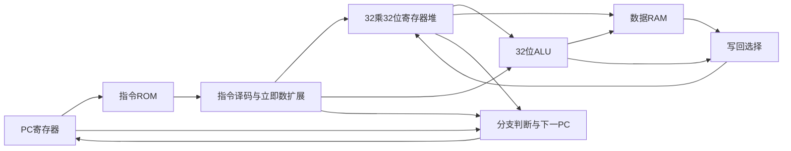

# EGO1单周期CPU仿真指南

本阶段将已验证的ALU和寄存器堆接入PC、指令ROM、LoongArch指令译码器及数据RAM，运行真实机器码程序。目标是理解一条指令如何从取指走到寄存器写回或内存写入，为后续流水线设计提供可比较的正确性基准。

该实验实现LA32中的15条指令，不实现完整LoongArch特权体系、异常向量或操作系统运行环境。本阶段仍是仿真与RTL综合阶段，尚未完成CPU上板。

## 打开与运行

1. 在当前Vivado窗口底部打开Tcl Console，输入 `close_sim` 关闭基础模块仿真。若询问是否保存波形，可自行保存。
2. File → Open Project，打开 `D:/Code/Vivado/ego1_cpu/single_cycle_project/ego1_single_cycle.xpr`。
3. 确认设计顶层为 single_cycle_soc，仿真顶层为 tb_single_cycle_cpu。
4. 点击 Run Simulation → Run Behavioral Simulation。工程设置为运行到测试结束，必要时在仿真启动后输入 `run all`。
5. 预期在676ns结束，并输出：

```text
FAULT TESTS PASSED: 10 cases, 226 checks
SINGLE CYCLE TESTS PASSED: 61 retired, 15 instruction kinds, 873 checks
Memory: result=12 sum=15 status=1; fault checks=226
```

`$finish called` 表示自动测试结束。两组测试合计1099项检查；主程序之外的故障测试使用另一个独立CPU实例。

本项目暂不添加板级引脚约束，不点击Generate Bitstream。设计顶层暴露的是内部观察信号，后续上板时会增加只有时钟、复位和显示等物理端口的板级顶层。

## 总体数据通路



图中回路包含时钟寄存器，不是组合反馈。一个CPU时钟周期内，指令ROM、译码、寄存器读取、ALU及需要的数据读取构成组合路径；在上升沿更新PC、目的寄存器或数据RAM。

## 已实现指令

| 类别 | 指令 |
| --- | --- |
| 寄存器算术 | ADD.W、SUB.W |
| 立即数与常数 | ADDI.W、LU12I.W |
| 逻辑 | AND、OR、XOR |
| 立即数移位 | SLLI.W、SRLI.W、SRAI.W |
| 字访存 | LD.W、ST.W |
| 分支 | BEQ、BNE、B |

以上是15种真实机器指令，不是15行程序或15个ALU控制码。当前还没有乘法、除法或流水线，不满足第4题的最终要求。

ADDI.W、LD.W、ST.W使用12位有符号立即数。LU12I.W把20位立即数放在结果高20位，低12位补零。条件分支比较rj和rd；ST.W的数据也来自rd，不是rk。

分支目标为分支指令自身PC加上符号扩展后的字节偏移，不是PC+4再加偏移。B的26位偏移字段在机器码中分成两段，译码时需要重新拼接；程序和故障测试均覆盖这一点。

## 测试程序在做什么

完整汇编见 `D:/Code/Vivado/ego1_cpu/programs/single_cycle_demo.s`，逐条机器码见同目录的 single_cycle_listing.md。

1. 写入r1=7、r2=5，执行ADD.W得到r3=12。
2. 将12存入数据地址0，再用LD.W读回。
3. 测试逻辑、移位、负立即数、常数构造、溢出截断和写r0。
4. 检查BEQ和BNE的跳转与不跳转；检查B向前和向后跳转。
5. 循环计算1+2+3+4+5，将结果15存入数据地址4。
6. 使用负偏移地址存取0x12345678，成功后向地址8写入通过标志1。
7. 运行B finish自循环。ISA没有在这里添加自定义HALT指令。

静态ROM包含55条指令，主测试执行61条动态指令后检查自循环保持，15种已实现指令全部被实际执行。二者数量不同，是因为有循环和被跳过的路径。

## 先看前五条指令的波形

把波形放大到30至90ns，观察trace信号。数据可右键选择Radix → Hexadecimal。

| 提交上升沿 | trace_pc | 指令 | 应观察到的效果 |
| --- | --- | --- | --- |
| 35ns | 00000000 | ADDI.W r1,r0,7 | trace_rd=1，trace_wdata=00000007 |
| 45ns | 00000004 | ADDI.W r2,r0,5 | trace_rd=2，trace_wdata=00000005 |
| 55ns | 00000008 | ADD.W r3,r1,r2 | trace_rd=3，trace_wdata=0000000c |
| 65ns | 0000000c | ST.W r3,r0,0 | trace_mem_we=1，地址0，写入0000000c |
| 75ns | 00000010 | LD.W r4,r0,0 | trace_rd=4，trace_wdata=0000000c |

trace信号在上升沿记录刚刚执行的指令，测试台在上升沿后1ns检查。PC本身也在同一上升沿更新，所以trace_pc=0时，pc已经为4，这是正常的。

## 最终观察值

| 信号 | 十六进制值 | 含义 |
| --- | --- | --- |
| result_word | 0000000c | 7+5=12 |
| sum_word | 0000000f | 1至5之和为15 |
| status_word | 00000001 | 程序通过标志 |
| fault | 0 | 主CPU无诊断故障 |
| pc | 000000d8 | 停留在终点自循环 |
| instruction | 50000000 | B到自身 |
| retired | 0000003d | 主测试核对61条动态指令 |

最终不是所有信号归零。与基础模块测试不同，这个测试在最后保留程序结果，方便观察。

## 存储器与诊断的范围

- 代码和数据分开。指令ROM使用组合读取，数据RAM为64个32位字，共256字节，采用异步读、上升沿写。
- 数据RAM按字节地址寻址，本阶段只支持4字节对齐的LD.W和ST.W。
- RAM在FPGA配置时初始化为0；CPU复位只复位PC、通用寄存器和诊断状态，保留RAM内容。
- result_word、sum_word、status_word是跟踪相应RAM写入的观察寄存器，与其对应内存字保持一致，不额外增加RAM读端口。
- 不支持的指令、取指无效、未对齐访问或越界访问会锁存fault并停止提交，防止继续错误写入。这是教学诊断机制，不是已实现LoongArch标准异常入口。
- 10个独立负面用例覆盖不支持的指令、64位指令误送入本32位子集、加载和存储地址错误、无效取指，以及不同方向和位段的B越界跳转。它们主动触发另一个CPU实例的故障，主CPU的fault应保持0。
- 测试台的10ns时钟仅用于行为仿真；行为仿真通过不代表硬件能以100MHz运行。实际上板频率需要约束、布局布线和时序报告确认。

## 文件与验证方法

| 文件 | 作用 |
| --- | --- |
| rtl/program_counter.v | 同步复位、按下一PC更新的寄存器 |
| rtl/instruction_rom.v | 由自编程序生成的机器码ROM |
| rtl/loongarch_decoder.v | 15种指令识别、源寄存器选择及立即数扩展 |
| rtl/single_cycle_cpu.v | 连接译码、寄存器、ALU、分支和写回 |
| rtl/data_ram.v | 256字节数据存储与结果观察 |
| rtl/single_cycle_soc.v | 组合CPU、代码ROM、数据RAM的实验顶层 |
| sim/tb_single_cycle_cpu.sv | 逐条核对主程序提交结果 |
| sim/cpu_fault_tests.sv | 独立实例的10种故障用例 |
| scripts/build_single_cycle_program.py | 生成机器码与基于助记符执行模型的预期轨迹 |

预期轨迹由Python对助记符对象执行得到，不复用硬件译码器。每条动态指令核对PC、机器码、下一PC、写回寄存器及数据、内存请求与写入、分支判断；此外核对最终结果和终点自循环。

修改测试程序时，应修改生成器中的程序，重新生成ROM、汇编清单和预期轨迹，随后重新仿真；不能仅修改预期值使错误结果通过。

仿真记录位于 `D:/Code/Vivado/ego1_cpu/validation/single_cycle_simulation.log`。RTL综合报告位于同目录的 single_cycle_utilization.rpt；这是不带板级引脚和时钟约束的模块综合，不是上板时序结论。

## 下一阶段

理解前五条指令的执行、分支回跳和最后的结果后，增加EGO1板级顶层、复位同步和显示逻辑，完成单周期上板。随后扩展指令并改成五级流水线，加入冒险处理和多周期乘除法，达到第4题要求。

## 技术依据

- LoongArch官方基本架构手册，指令功能与机器编码： https://loongson.github.io/LoongArch-Documentation/LoongArch-Vol1-EN.html
- AMD Vivado 2025.2存储器读取时序： https://docs.amd.com/r/2025.2-English/ug901-vivado-synthesis/Choosing-Between-Distributed-RAM-and-Dedicated-Block-RAM
- AMD Vivado 2025.2行为仿真入口： https://docs.amd.com/r/en-US/ug937-vivado-design-suite-simulation-tutorial/Step-1-Opening-the-Project
